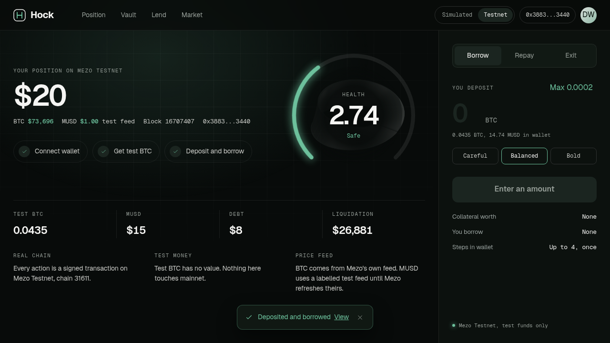

# Hock

Borrow MUSD against your share of a BTC/MUSD liquidity position on Mezo.

Hock pools BTC and MUSD into a staked Mezo concentrated-liquidity position and gives depositors ERC-20 shares. Those shares are accepted as collateral in a Morpho market, so the principal sitting inside an LP position can back a MUSD loan without being unwound.

- **Live app:** https://hock-preview.vercel.app (simulation at `/app/`, real Mezo Testnet at `/app/testnet/`)
- **Pitch video (2:07):** https://github.com/itachi-exe/hock/releases/download/submission-v1/hock-pitch.mp4
- **Deck (8 slides):** https://hock-preview.vercel.app/deck.pdf



- **Network:** Mezo Testnet, chain id `31611`, RPC `https://rpc.test.mezo.org`
- **Status:** testnet only. Unaudited. Nothing here is deployed to mainnet.

## How it works

```
BTC + MUSD -> HockVault -> MezoCLAdapter -> Mezo CL position (staked in the gauge)
                 |
            HOCK shares -> Morpho market (collateral) -> borrow MUSD
```

1. **Deposit.** The vault takes BTC and MUSD, adds liquidity through the adapter on a fixed wide range, stakes the position in the gauge and mints shares. Anything the pool does not take is refunded exactly.
2. **Lock.** Shares are supplied to Morpho as collateral.
3. **Borrow.** MUSD is borrowed from the market at up to 77% LLTV.
4. **Repay and exit.** Debt is repaid by borrow shares (so no dust is left), collateral is released, and the vault shares are redeemed for BTC and MUSD.

`HockOracle` prices a share from the BTC/USD and MUSD/USD feeds, never from the pool's spot price. Deposits and harvests revert if spot sits more than 5% away from the fair price.

## Deployed contracts (Mezo Testnet)

All seven are source-verified on the explorer.

| Contract | Address |
|---|---|
| HockVault | [`0x5600BDF9c5d6163D73b12e1312f708Cd8916E0c4`](https://explorer.test.mezo.org/address/0x5600BDF9c5d6163D73b12e1312f708Cd8916E0c4) |
| HockOracle | [`0x6691C934eD714E8403e89c5f0Be83bdBD964a6c9`](https://explorer.test.mezo.org/address/0x6691C934eD714E8403e89c5f0Be83bdBD964a6c9) |
| MezoCLAdapter | [`0xF9Bd22C3593d5557f63d77D9642290A82fba09B5`](https://explorer.test.mezo.org/address/0xF9Bd22C3593d5557f63d77D9642290A82fba09B5) |
| HockRouter (deployed, not used by the UI) | [`0xB867956bD3Aeb65cD3587bB00eA29339f49E5884`](https://explorer.test.mezo.org/address/0xB867956bD3Aeb65cD3587bB00eA29339f49E5884) |
| MezoPriceFeedAdapter (BTC/USD) | [`0x8157deD1Bf3aA6d0E07212a125eE036A8170Dd37`](https://explorer.test.mezo.org/address/0x8157deD1Bf3aA6d0E07212a125eE036A8170Dd37) |
| MezoSwapAdapter | [`0x70cD55315ee37DD6528c89A3E4ad410f3F1bbd03`](https://explorer.test.mezo.org/address/0x70cD55315ee37DD6528c89A3E4ad410f3F1bbd03) |
| TestnetFeed (MUSD/USD stand-in, see below) | [`0xBA3818256D2D7E6a60aB9FdA9DBAF5018d81997c`](https://explorer.test.mezo.org/address/0xBA3818256D2D7E6a60aB9FdA9DBAF5018d81997c) |

Morpho market id: `0x673871dad81694407421df4e1b333baf8a4d7b34a09c8b655f9259ac37c8f5cf` (loan MUSD, collateral HOCK shares, LLTV 0.77).

Mezo contracts used as is: canonical testnet MUSD `0x118917a40FAF1CD7a13dB0Ef56C86De7973Ac503`, Morpho `0xCe1da828cA15cb1FDAfa84C366A53C8106655a73`, BTC/MUSD CL pool `0xFe31b6033BCda0ebEc9FB789ee21bbc400175997`.

## Proof: one full cycle through the UI

These transactions were signed by a wallet driving the real `/app/testnet/` page in a browser, on 2026-11-10. Deposit 0.0002 BTC plus MUSD, borrow 8 MUSD, repay, withdraw everything.

| Step | Transaction |
|---|---|
| Approve BTC | [`0x0499466f...`](https://explorer.test.mezo.org/tx/0x0499466f08750cb737fd942e95b579a01e5e5d591a7516906e2dce82fe2a45b5) |
| Approve MUSD | [`0x1009d2b5...`](https://explorer.test.mezo.org/tx/0x1009d2b5d724103ade335b268b7fec132d87f01c992458cb198e74cbb4fbb1e9) |
| Deposit into the vault | [`0x3267a266...`](https://explorer.test.mezo.org/tx/0x3267a26660437964ba56c874e6ddebf5b6aca5dc6173e0220bcc588a97159a52) |
| Approve shares | [`0xb5fe095e...`](https://explorer.test.mezo.org/tx/0xb5fe095e7b89155acf94d5110762f05e10f35136dfac6992c888ea0169dcd239) |
| Lock shares as collateral | [`0xb3888b35...`](https://explorer.test.mezo.org/tx/0xb3888b35587b1357c70dc73555894278fc7ff97265ca21bfa3dd74c9f10648c3) |
| Borrow MUSD | [`0x40853ba6...`](https://explorer.test.mezo.org/tx/0x40853ba647af7fc957de048f769a7c01a9444d2e8de1138c08b81871d973e175) |
| Repay in full | [`0x751879da...`](https://explorer.test.mezo.org/tx/0x751879dae5956ff56010a2afdb51aff11decd1b40d76baff6c53df2326900dc3) |
| Release collateral | [`0x871f6567...`](https://explorer.test.mezo.org/tx/0x871f6567e49270986214752114f9572ef5ca887246781c0cb3e8e42dd469c747) |
| Withdraw from the vault | [`0xe7e6402f...`](https://explorer.test.mezo.org/tx/0xe7e6402f2481ee97e3c3a300593848d9f95edd21633d203c402f4399568b924e) |

The cycle was repeated on 2026-11-11 against the final build by `web/e2e/testnet-live.mjs` (approvals were already in place, so six transactions): [deposit](https://explorer.test.mezo.org/tx/0xe5a079421f2a34bcdf6f85e5dd72ab1bdc3c216609ba5c56f1931edb5fa8a06c), [lock](https://explorer.test.mezo.org/tx/0x4bbcfa028edd1de8b2a169eb516eccbb2dbd824fd3a1bcdd0635f57e27c27afa), [borrow](https://explorer.test.mezo.org/tx/0xae66686f4b36d3c972df0622b52ff4fc52edc4325d7a7c0c5ef17c7acb43a0f1), [repay](https://explorer.test.mezo.org/tx/0xc71e80f541f276d83194f9797a2eccea549cde9b43f44f7f40d0ea75dc340556), [release](https://explorer.test.mezo.org/tx/0x4cf2b57352b4d76bcd6ecb43e464344b9ac23e44192322a63586c9bb9b102b72), [withdraw](https://explorer.test.mezo.org/tx/0x238c578ea486d3e1eb32172ed887c3d41152c0c3dbc6aef92d8acc58122bb30b).

The signing wallet is the team's own deployer. No outside user has used Hock yet.

## Try it

1. Get test BTC from https://faucet.test.mezo.org/.
2. Get test MUSD by opening a trove on Mezo Testnet (MUSD has no faucet). A deposit needs both tokens.
3. Open `/app/testnet/`, connect a wallet, and the app adds or switches to Mezo Testnet.
4. Deposit and borrow, then repay, then exit.

No wallet? `/app/` runs the same flows on a clearly labelled simulation with no keys and no chain.

## Fee

10% of harvested MEZO gauge rewards goes to the treasury (`FEE_BPS = 1000`). The rest is swapped to BTC and MUSD and held by the vault for shareholders. There is no deposit, withdraw or borrow fee. Borrow interest is set by the Morpho market and goes to its lenders.

## Risk handling

- **MUSD depeg.** MUSD is never assumed to be one dollar. The share price is BTC/USD divided by MUSD/USD, so a depeg moves collateral value and loan health directly. If spot drifts more than 5% from the fair price, deposits and harvests revert until it converges.
- **Stale or bad prices.** A zero price, a future-dated price, or one older than 24 hours reverts the valuation. Morpho then cannot open new borrows or liquidate against a price Hock does not trust. That is a deliberate freeze, and it also means liquidations pause while a feed is down.
- **Mezo Recovery Mode.** Hock does not open troves, so it has no trove that Recovery Mode can liquidate. The exposure is indirect: Recovery Mode makes new MUSD harder to mint, so MUSD can trade above a dollar and market liquidity can thin out. Borrowers then owe a more expensive asset, and lenders may wait longer to withdraw. Hock has no special handling for this beyond the oracle pricing MUSD at its feed value.
- **Liquidation.** Positions above 77% loan to value can be liquidated on Morpho. The liquidator receives vault shares and redeems them for BTC and MUSD.
- **LP risk.** Collateral is a liquidity position, so it carries impermanent loss on top of BTC price risk.

## Known limits

- **The MUSD price is a stand-in on testnet.** Mezo's testnet Pyth MUSD/USD feed is stale, so the market reads `TestnetFeed`, an owner-pushed price fixed at 1 USD and labelled `TESTNET FEED, NOT A MARKET PRICE` on chain and in the UI. The MUSD token itself is the canonical testnet MUSD. The BTC/USD price is Mezo's real feed. `keeper/feed-keeper.sh` refreshes the stand-in.
- **One-click deposit and borrow does not work on Mezo.** `HockRouter` only succeeds with roughly 9M gas against a 10M block limit, so the UI sends the steps as separate transactions with explicit gas limits.
- **Each deposit opens its own staked position, up to 8.** Adding to an existing staked position failed on Mezo Testnet for a reason we did not pin down, so the vault avoids that path.
- **Only the borrow page is on chain.** The Vault, Lend and Market pages are simulation only and say so.
- **Owner powers.** The deployer is the harvest keeper, the treasury and the TestnetFeed owner. There is no timelock or multisig.
- **No TWAP.** The drift guard compares spot to the feed price, with no time-weighted check.
- Not audited.

## Run it

Contracts (Foundry):

```
forge build
forge test
```

32 tests pass. Two fork suites skip unless you pass `--fork-url https://rpc.test.mezo.org`.

Web app (Node 22):

```
cd web
npm ci
npm test
npm run build
```

74 unit tests pass. The static export lands in `web/out/`.

Deploy script: `script/DeployTestnet.s.sol`. Private keys are read from the environment and are never committed.

## Layout

- `src/` contracts: `HockVault`, `HockOracle`, `HockRouter`, `adapters/`, `testnet/TestnetFeed`
- `test/` Foundry tests and mocks
- `web/` Next.js app: landing page, simulation, and the testnet page (`web/app/app/testnet/`, chain wiring in `web/app/app/chain-context.jsx`)
- `keeper/` feed refresh script
- `pitch/` deck source and PDF
- `TESTNET.md` short address list

## License

MIT
